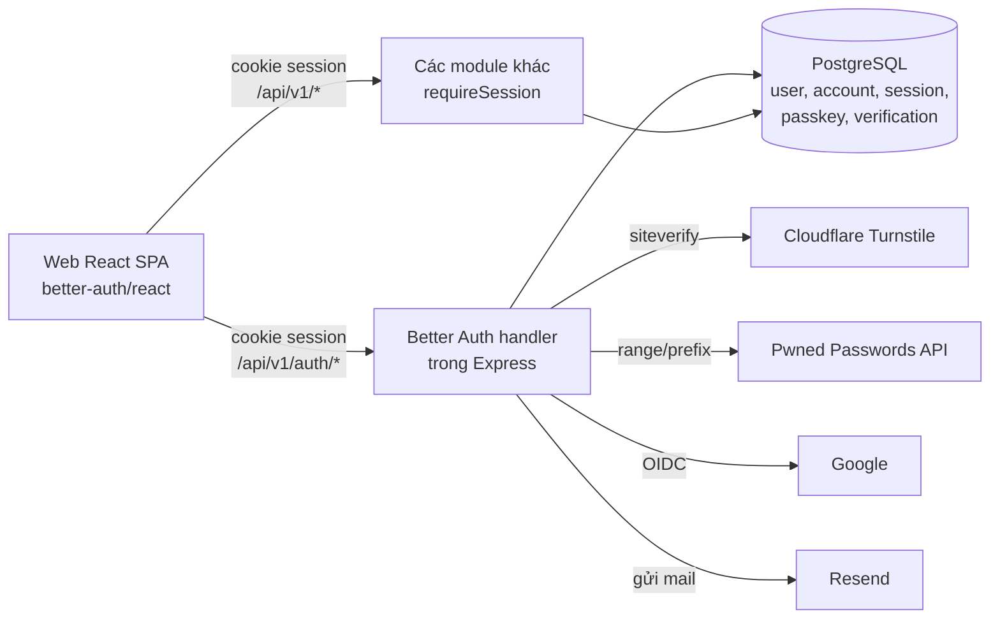
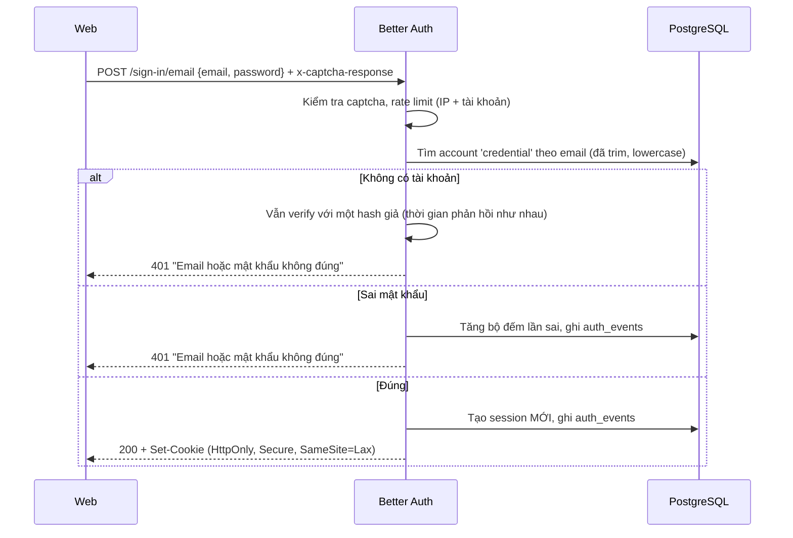
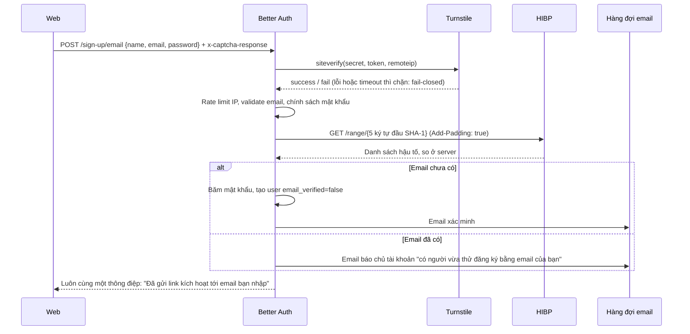
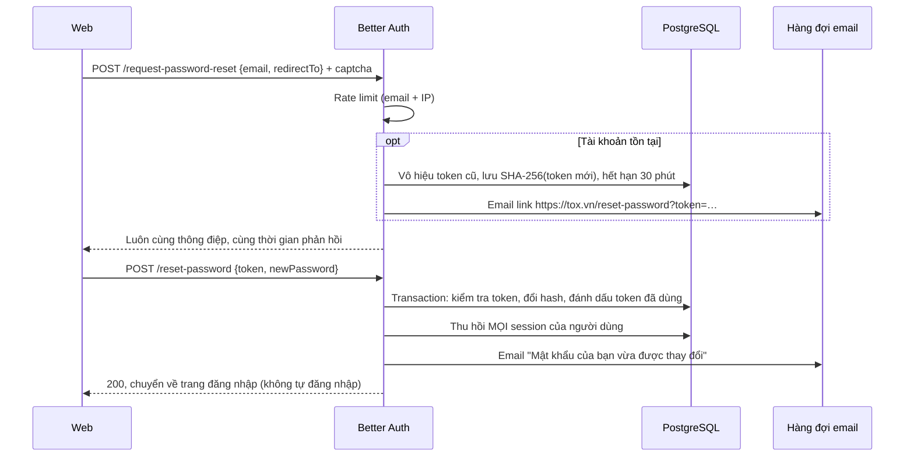
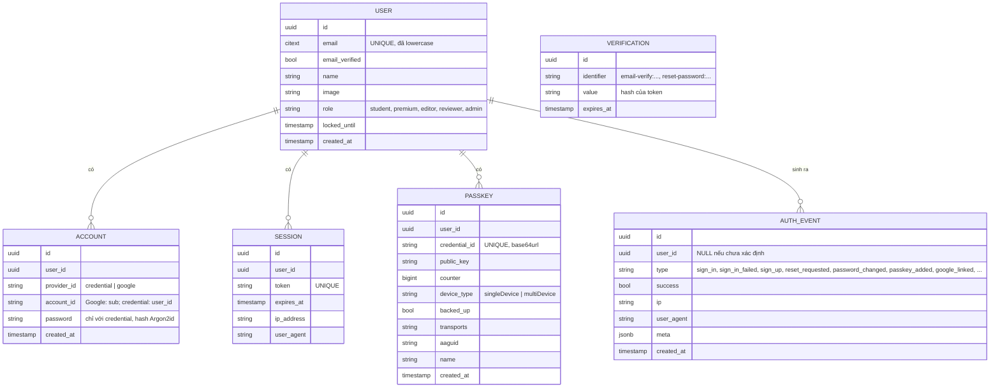

# Xác thực (đăng ký, đăng nhập, quên mật khẩu)

| Thuộc tính | Giá trị |
| --- | --- |
| Trạng thái | Đề xuất (chờ chốt) |
| Ngày | 22/11/2026 |
| Yêu cầu | CB-01, PF-05 trong [spec](../spec/yeu-cau-ban-dau.md) |
| Liên quan | [Kiến trúc v1](./v1.md) (module `auth`), [task triển khai](../tasks/auth.md) |

Tài liệu này mô tả cách TOX triển khai:

- **Đăng nhập:** email + mật khẩu, Google (OAuth 2.0 / OpenID Connect), passkey (WebAuthn).
- **Đăng ký:** email + mật khẩu, có CAPTCHA, xác minh email.
- **Quên mật khẩu / đặt lại mật khẩu.**

## 1. Quyết định chính (ADR)

### 1.1 Dùng Better Auth, không tự viết từ đầu

| Phương án | Kết luận |
| --- | --- |
| **Better Auth** (mã nguồn mở, tự host) | **Chọn.** Có sẵn email/mật khẩu, Google, passkey (plugin `@better-auth/passkey`, chạy trên SimpleWebAuthn), CAPTCHA (plugin `captcha`), kiểm tra mật khẩu bị lộ (plugin `haveIBeenPwned`), rate limit. Có handler cho Express và client cho React. Dữ liệu nằm trong PostgreSQL của TOX. |
| Tự viết (`@node-rs/argon2`, `openid-client`, `@simplewebauthn/server`) | Kiểm soát tối đa nhưng tốn 3–5 tuần và nhiều chỗ dễ sai (account linking, token reset, challenge WebAuthn). |
| Passport.js | Chỉ lo phần OAuth, phần còn lại vẫn phải tự viết. |
| Auth.js (NextAuth) | Gắn với Next.js; dự án đã nhập về Better Auth và chỉ còn nhận bản vá bảo mật. |
| Lucia | v3 đã ngừng phát triển (03/2025), giờ chỉ là tài liệu tham khảo. Dùng để hiểu cách tự viết. |
| Clerk / Auth0 / Supabase Auth | Nhanh nhưng dữ liệu người dùng ở bên thứ ba, tính phí theo MAU, phụ thuộc nhà cung cấp. |
| Keycloak | Quá nặng cho MVP (thêm một server Java phải vận hành). |

Điều kiện khi dùng Better Auth:

- Phiên bản **≥ 1.6.11** (bản sửa lỗ hổng pre-account hijacking GHSA-g38m-r43w-p2q7). Pin phiên bản, bật Renovate, theo dõi GitHub Security Advisories của dự án.
- Đội vẫn phải review cấu hình theo checklist ở [mục 10](#10-checklist-review-bảo-mật). Thư viện làm thay phần code, không làm thay phần cấu hình.

### 1.2 Session lưu trong DB + cookie HttpOnly, thay cho JWT

[Kiến trúc v1](./v1.md) và PF-05 đang ghi "JWT access token 15 phút + refresh token trong cookie". Tài liệu này đề xuất đổi sang **session lưu DB, ID gửi qua cookie** vì:

- Web là SPA, chạy cùng site với API, nên cookie là đủ và đơn giản nhất.
- Thu hồi được ngay (đăng xuất, đổi mật khẩu, khóa tài khoản), không phải chờ token hết hạn.
- JavaScript không đọc được cookie HttpOnly, nên XSS không lấy được phiên.
- Không phải tự làm refresh token rotation và phát hiện token bị dùng lại.

Khi có app mobile hoặc bên thứ ba gọi API, bật thêm plugin `bearer`/`jwt` của Better Auth. Khi chốt tài liệu này, cập nhật lại PF-05 trong spec.

### 1.3 Các lựa chọn khác

| Hạng mục | Lựa chọn | Lý do ngắn |
| --- | --- | --- |
| Băm mật khẩu | Argon2id, m=19 MiB, t=2, p=1 (mức tối thiểu của OWASP) | Better Auth mặc định dùng scrypt (OWASP cũng chấp nhận); override sang Argon2id bằng `@node-rs/argon2`. Benchmark trên server thật trước khi chốt. |
| CAPTCHA | Cloudflare Turnstile | Gói free không giới hạn lượt; thường không bắt giải ảnh; không cần chuyển DNS sang Cloudflare. reCAPTCHA chỉ miễn phí 10.000 lượt/tháng, dễ vượt vào mùa thi. |
| Email | Resend + React Email | API gọn. Gói free 3.000 email/tháng, tối đa 100/ngày: khi lượng đăng ký tăng thì lên gói trả phí hoặc chuyển Amazon SES. |
| Google | Redirect flow phía server (Authorization Code + PKCE) | Server giữ client secret, có sẵn trong Better Auth. Google One Tap là tùy chọn, làm sau. |
| Passkey | `@better-auth/passkey` (SimpleWebAuthn v14, cần Node ≥ 22; repo đang dùng Node 24) | |
| Độ dài mật khẩu tối thiểu | **12 ký tự** (chờ chốt) | NIST SP 800-63B-4 yêu cầu 15 khi mật khẩu là yếu tố duy nhất. TOX chọn 12 để dễ dùng, bù lại bằng kiểm tra HIBP, thanh đo độ mạnh và khuyến khích passkey/Google. Nếu muốn theo đúng NIST thì đặt 15. |

## 2. Tổng quan hệ thống



### 2.1 Cùng site là bắt buộc

Cookie session và cookie `state` của OAuth không đi qua được giữa hai domain khác nhau. Web và API phải cùng site:

- **Production:** `tox.vn` phục vụ SPA, `tox.vn/api/*` đi qua reverse proxy tới backend (khuyến nghị). Hoặc `api.tox.vn` (cùng domain gốc `tox.vn`).
- **Local:** `localhost:5173` và `localhost:8080` là cùng site (cổng không tính), chạy được ngay.

### 2.2 Gắn vào Express

Better Auth chạy dưới `/api/v1/auth/*` (đặt `basePath: "/api/v1/auth"`) để giữ tiền tố API thống nhất.

Thứ tự middleware trong `backend/src/server.ts` phải đổi: handler của Better Auth đặt **trước** `express.json()`, nếu không request sẽ bị treo.

```ts
app.set("trust proxy", env.TRUST_PROXY);
app.use(cors({ origin: env.CORS_ORIGIN, credentials: true }));
app.use(helmet());
app.all("/api/v1/auth/*splat", toNodeHandler(auth)); // Express 5
app.use(express.json());
app.use(express.urlencoded({ extended: true }));
app.use(rateLimiter);
// ... các route /api/v1 khác
```

Các route khác lấy người dùng hiện tại bằng middleware:

```ts
// backend/src/common/middleware/requireSession.ts
const session = await auth.api.getSession({ headers: fromNodeHeaders(req.headers) });
if (!session) return res.status(401).json(/* ServiceResponse.failure */);
req.user = session.user;
```

`requireFreshSession` giống trên, nhưng chỉ nhận session vừa tạo gần đây (ví dụ trong 10 phút). Dùng cho thao tác nhạy cảm: đổi email, đổi mật khẩu, thêm/xóa passkey, liên kết/hủy liên kết Google.

### 2.3 Cấu hình trung tâm (phác thảo)

```ts
// backend/src/api/auth/auth.ts
export const auth = betterAuth({
  baseURL: env.BETTER_AUTH_URL,          // dựng mọi link trong email từ đây, không từ header Host
  basePath: "/api/v1/auth",
  secret: env.BETTER_AUTH_SECRET,
  trustedOrigins: [env.CORS_ORIGIN],
  database: drizzleAdapter(db, { provider: "pg" }),
  emailAndPassword: {
    enabled: true,
    requireEmailVerification: true,
    minPasswordLength: 12,
    maxPasswordLength: 128,
    revokeSessionsOnPasswordReset: true,
    resetPasswordTokenExpiresIn: 30 * 60,  // 30 phút
    password: { hash: argon2Hash, verify: argon2Verify },
    sendResetPassword: async ({ user, url }) => mailQueue.resetPassword(user, url),
  },
  emailVerification: {
    sendVerificationEmail: async ({ user, url }) => mailQueue.verifyEmail(user, url),
    expiresIn: 24 * 60 * 60,               // 24 giờ
  },
  socialProviders: {
    google: { clientId: env.GOOGLE_CLIENT_ID, clientSecret: env.GOOGLE_CLIENT_SECRET },
  },
  account: {
    accountLinking: {
      enabled: true,
      trustedProviders: ["google"],
      requireLocalEmailVerified: true,     // KHÔNG tắt
      allowDifferentEmails: false,
    },
  },
  session: { expiresIn: 30 * 24 * 60 * 60, updateAge: 24 * 60 * 60, freshAge: 10 * 60 },
  rateLimit: { enabled: true, storage: "database", customRules: { /* mục 3.3 */ } },
  plugins: [
    captcha({ provider: "cloudflare-turnstile", secretKey: env.TURNSTILE_SECRET_KEY }),
    haveIBeenPwned(),
    passkey({ rpID: env.PASSKEY_RP_ID, rpName: "TOX", origin: env.CORS_ORIGIN }),
  ],
});
```

Tên tùy chọn có thể khác giữa các phiên bản. Đối chiếu với tài liệu Better Auth đúng phiên bản đã pin trước khi code.

### 2.4 Biến môi trường mới

| Biến | Ở đâu | Ghi chú |
| --- | --- | --- |
| `DATABASE_URL` | backend | PostgreSQL |
| `BETTER_AUTH_SECRET` | backend | Chuỗi ngẫu nhiên ≥ 32 byte, khác nhau giữa các môi trường |
| `BETTER_AUTH_URL` | backend | URL gốc công khai, ví dụ `https://tox.vn` |
| `GOOGLE_CLIENT_ID`, `GOOGLE_CLIENT_SECRET` | backend | Từ Google Cloud Console |
| `TURNSTILE_SECRET_KEY` | backend | Local/test dùng secret test của Cloudflare |
| `VITE_TURNSTILE_SITE_KEY` | web | Site key công khai |
| `RESEND_API_KEY`, `MAIL_FROM` | backend | Ví dụ `TOX <no-reply@mail.tox.vn>` |
| `PASSKEY_RP_ID` | backend | `tox.vn` ở production, `localhost` ở local. Không đổi sau khi chạy thật, đổi là mất toàn bộ passkey. |

## 3. Đăng nhập bằng email + mật khẩu

### 3.1 Luồng



### 3.2 Best practices

- **Thông báo lỗi chung** cho mọi trường hợp thất bại (sai email, sai mật khẩu, tài khoản bị khóa): "Email hoặc mật khẩu không đúng." Cùng HTTP status, cùng thời gian phản hồi. Không bao giờ trả "không tìm thấy người dùng".
- **Session ID mới** sau mỗi lần đăng nhập hoặc đổi quyền (chống session fixation).
- **Cookie:** `HttpOnly`, `Secure` (production), `SameSite=Lax`, không đặt `Domain` rộng nếu không cần.
- **CSRF:** `SameSite=Lax` + kiểm tra `Origin` theo `trustedOrigins` (Better Auth đã làm). Mọi thao tác thay đổi dữ liệu dùng POST/PUT/DELETE, không dùng GET.
- **Form:** cho phép dán (paste) và password manager, có nút hiện/ẩn mật khẩu, `autocomplete="username webauthn"` cho ô email và `autocomplete="current-password"` cho ô mật khẩu.
- **Rate limit chạy trước bước băm mật khẩu.** Argon2id tốn RAM (19 MiB mỗi lần), không chặn trước thì endpoint đăng nhập thành chỗ để tấn công DoS.
- **Không log** mật khẩu, token, cookie.

### 3.3 Rate limit và khóa tạm thời

OWASP không đưa ngưỡng cố định. Đề xuất ban đầu, tinh chỉnh theo log thực tế:

| Đối tượng | Ngưỡng |
| --- | --- |
| Theo tài khoản | Sai 5 lần trong 15 phút: bắt đầu trễ tăng dần (1s, 2s, 4s…) và bắt CAPTCHA. Sai 10 lần: khóa tạm 15 phút. Không khóa vĩnh viễn (tránh bị lợi dụng để khóa tài khoản người khác); người dùng mở khóa được bằng luồng quên mật khẩu. |
| `/sign-in/*` theo IP | ~20 request/phút |
| `/sign-up/email` theo IP | ~5 request/giờ |
| `/request-password-reset` | ~3 request/email/giờ, ~10 request/IP/giờ |

Bộ đếm lần sai phải gắn với **tài khoản**, không chỉ theo IP (tấn công credential stuffing dùng nhiều IP). Rate limit lưu trong DB ở MVP; khi chạy từ 2 instance trở lên thì chuyển sang Redis.

## 4. Đăng nhập bằng Google

### 4.1 Luồng (Authorization Code + PKCE)

```mermaid
sequenceDiagram
    participant FE as Web
    participant BA as Better Auth
    participant G as Google
    FE->>BA: signIn.social({ provider: "google", callbackURL })
    BA->>BA: Sinh state, nonce, code_verifier (PKCE S256), lưu cookie tạm 10 phút
    BA-->>FE: Redirect tới accounts.google.com (scope: openid email profile)
    FE->>G: Người dùng đồng ý
    G-->>BA: GET /callback/google?code&state
    BA->>BA: So khớp state TRƯỚC mọi xử lý
    BA->>G: Đổi code + code_verifier lấy token
    BA->>BA: Verify ID token: chữ ký, iss, aud = client ID, exp, nonce
    BA->>BA: Tìm account theo (google, sub); xử lý linking (mục 4.3)
    BA-->>FE: Set-Cookie session, redirect về callbackURL
```

### 4.2 Cấu hình Google Cloud Console

1. Tạo project, cấu hình OAuth consent screen: tên "TOX", logo, link trang chủ, chính sách quyền riêng tư, điều khoản.
2. Tạo OAuth client ID loại **Web application**.
3. Authorized JavaScript origins: `https://tox.vn`, `http://localhost:5173`.
4. Authorized redirect URIs: `https://tox.vn/api/v1/auth/callback/google`, `http://localhost:8080/api/v1/auth/callback/google`.
5. Chỉ xin scope `openid email profile` (không cần Google duyệt). Không xin scope Gmail/Drive.
6. Chuyển app sang **In production**. Ở chế độ Testing chỉ test user đăng nhập được.

### 4.3 Liên kết tài khoản (account linking)

Đây là chỗ dễ có lỗ hổng nhất. Ví dụ tấn công "pre-account hijacking": kẻ xấu đăng ký trước `nannhan@gmail.com` bằng mật khẩu (không xác minh được email). Sau đó nạn nhân đăng nhập bằng Google, hệ thống tự liên kết vào tài khoản của kẻ xấu, và kẻ xấu vẫn đăng nhập được bằng mật khẩu.

Quy tắc của TOX:

- Định danh tài khoản Google bằng `sub`, **không** dùng email làm khóa.
- Chỉ tự động liên kết khi Google trả `email_verified = true` **và** email của tài khoản TOX đã được xác minh (`requireLocalEmailVerified: true`).
- Nếu tài khoản TOX chưa xác minh email: không liên kết; yêu cầu người dùng đăng nhập bằng mật khẩu trước rồi liên kết trong trang Bảo mật.
- Thận trọng hơn (khuyến nghị): chỉ tự liên kết khi email có đuôi `@gmail.com` hoặc ID token có `hd` (Google Workspace). Với email khác, Google không phải bên quản lý hộp thư nên `email_verified` có thể không còn đúng. Các trường hợp này bắt người dùng liên kết thủ công khi đã đăng nhập.
- Liên kết/hủy liên kết thủ công yêu cầu fresh session. Không cho hủy phương thức đăng nhập cuối cùng.

### 4.4 Lỗi cần tránh

- Không kiểm tra `state`, hoặc tin ID token do client gửi lên mà không verify.
- Quên kiểm tra `aud`.
- `callbackURL` không giới hạn, thành open redirect. Chỉ cho phép đường dẫn nội bộ.
- Lưu access token của Google dạng rõ. TOX không cần gọi API Google nên không cần lưu.

### 4.5 Google One Tap (tùy chọn, làm sau)

Plugin `one-tap` của Better Auth. Server vẫn phải verify ID token và cookie `g_csrf_token`. Khi bật, thêm `https://accounts.google.com/gsi/` vào CSP (`script-src`, `frame-src`, `connect-src`).

## 5. Passkey (WebAuthn)

### 5.1 Tạo passkey (người dùng đã đăng nhập)

1. Web gọi `authClient.passkey.addPasskey({ name })`.
2. Server sinh registration options: `rpID`, `rpName: "TOX"`, `userID` là ID ngẫu nhiên (**không** dùng email), `attestationType: "none"`, `excludeCredentials` là các passkey đã có, `residentKey: "required"`, `userVerification: "preferred"`.
3. Challenge lưu ở server, sống ~5 phút, **chỉ dùng một lần**.
4. Trình duyệt tạo passkey, gửi kết quả về. Server verify với `expectedOrigin` và `expectedRPID` lấy từ cấu hình (**không** lấy từ header request).
5. Lưu: `credentialID`, `publicKey`, `counter`, `transports`, `deviceType`, `backedUp`, `aaguid`, tên. Gửi email "Tài khoản của bạn vừa được thêm passkey mới".

Thời điểm gợi ý tạo passkey: ngay sau lần đăng nhập bằng mật khẩu hoặc Google, và trong trang Bảo mật.

### 5.2 Đăng nhập bằng passkey

- **Nút "Đăng nhập bằng passkey":** `authClient.signIn.passkey()`, `allowCredentials` rỗng (discoverable credential), người dùng không cần nhập email.
- **Conditional UI (passkey hiện trong gợi ý autofill của ô email):** khi trang đăng nhập tải xong, nếu `PublicKeyCredential.isConditionalMediationAvailable()` trả true thì gọi `authClient.signIn.passkey({ autoFill: true })`. Ô email cần `autocomplete="username webauthn"`. Trình duyệt không hỗ trợ thì form vẫn chạy bình thường.
- Server tra `credentialID` ra người dùng, verify chữ ký, cập nhật `counter`, `backedUp`, `lastUsedAt`, tạo session mới.
- **Counter:** passkey đồng bộ (iCloud Keychain, Google Password Manager) thường luôn trả `0`. Chỉ cảnh báo khi counter giảm từ một giá trị khác 0, không bắt buộc counter phải tăng.

### 5.3 Quản lý và khôi phục

- Mỗi người dùng có thể có nhiều passkey. Trang Bảo mật hiển thị tên (gợi ý từ AAGUID), ngày tạo, lần dùng cuối; cho đổi tên và xóa (xóa cần fresh session).
- Mất passkey: khôi phục qua email (luồng quên mật khẩu để đặt mật khẩu, rồi thêm passkey mới) hoặc qua Google nếu đã liên kết. Không dùng câu hỏi bảo mật.
- Không cho xóa phương thức đăng nhập cuối cùng.

### 5.4 Kiểm thử

Chrome DevTools có virtual authenticator (tab WebAuthn). E2E dùng Playwright + CDP `WebAuthn.addVirtualAuthenticator`.

## 6. Đăng ký bằng email + mật khẩu (có CAPTCHA)

### 6.1 Luồng



### 6.2 CAPTCHA (Cloudflare Turnstile)

- Web dùng `@marsidev/react-turnstile`, gửi token qua header `x-captcha-response`.
- Server (plugin `captcha`) gọi `https://challenges.cloudflare.com/turnstile/v0/siteverify`, kiểm tra `success` và `hostname`.
- Token chỉ dùng được một lần: mỗi lần gửi lại form phải reset widget.
- Áp dụng cho `/sign-up/email`, `/sign-in/email`, `/request-password-reset`.
- Local và CI dùng key test của Cloudflare (luôn pass / luôn fail) để test cả hai nhánh.
- Thêm `https://challenges.cloudflare.com` vào CSP (`script-src`, `frame-src`).

### 6.3 Chính sách mật khẩu (theo NIST SP 800-63B-4)

- Tối thiểu 12 ký tự (xem [1.3](#13-các-lựa-chọn-khác)), tối đa 128. Chấp nhận Unicode và khoảng trắng, không cắt bớt.
- **Không** bắt có chữ hoa/số/ký tự đặc biệt, **không** bắt đổi định kỳ. Chỉ bắt đổi khi có dấu hiệu bị lộ.
- Chặn: mật khẩu phổ biến, chứa "tox"/"toeic", trùng email, và mật khẩu đã lộ theo HIBP.
- HIBP dùng k-anonymity: chỉ gửi 5 ký tự đầu của SHA-1, không gửi mật khẩu hay hash đầy đủ. HIBP không phản hồi (timeout ~2s) thì cho qua và ghi log.
- Thanh đo độ mạnh ở web bằng `zxcvbn-ts`, gợi ý dùng cụm từ (passphrase).

### 6.4 Xác minh email

- Token ngẫu nhiên ≥ 128 bit (CSPRNG). Trong DB chỉ lưu SHA-256 của token.
- Hết hạn 24 giờ, dùng một lần; gửi lại thì token cũ mất hiệu lực. Gửi lại có rate limit.
- Trang `/verify-email?token=…` cần người dùng bấm nút xác nhận (gửi POST), không xác minh ngay khi mở link. Lý do: trình quét link của một số dịch vụ email tự mở link và làm mất token.
- Chưa xác minh thì không đăng nhập được (`requireEmailVerification: true`). Câu hỏi cho sản phẩm: có cho khách làm bài thử trước rồi mới bắt xác minh khi lưu kết quả không? (Spec đã cho khách làm test dùng thử không lưu kết quả.)

### 6.5 Chống tài khoản rác

Turnstile, rate limit theo IP, chặn domain email dùng một lần (danh sách mở, cập nhật định kỳ), theo dõi tỷ lệ đăng ký không xác minh.

## 7. Quên mật khẩu / đặt lại mật khẩu

### 7.1 Luồng



### 7.2 Best practices

- Thông điệp luôn giống nhau: "Nếu email này có tài khoản TOX, chúng tôi đã gửi link đặt lại mật khẩu." Gửi email qua hàng đợi để thời gian phản hồi không để lộ tài khoản có tồn tại hay không.
- Token ≥ 128 bit, lưu SHA-256, hết hạn 30 phút, dùng một lần.
- Không thay đổi gì trên tài khoản (không khóa, không đổi mật khẩu) khi mới chỉ có yêu cầu reset.
- **Link dựng từ `BETTER_AUTH_URL`, không từ header `Host`/`X-Forwarded-Host`** (chống password reset poisoning). `redirectTo` chỉ nhận đường dẫn nội bộ.
- Áp lại chính sách mật khẩu và HIBP cho mật khẩu mới.
- Sau khi đặt lại: thu hồi mọi session, không tự đăng nhập, gửi email thông báo kèm cách liên hệ nếu không phải họ.
- Tài khoản chỉ dùng Google/passkey: vẫn trả thông điệp chung; email gửi đi cho phép đặt mật khẩu lần đầu. Đây cũng là đường khôi phục khi mất passkey.
- Đổi mật khẩu khi đang đăng nhập: yêu cầu mật khẩu hiện tại (hoặc fresh session), sau đó thu hồi các session khác.

### 7.3 Email

- Resend + React Email, tiếng Việt, luôn có bản text thuần, không đặt token trong tiêu đề.
- Cấu hình SPF, DKIM, DMARC cho domain gửi (ví dụ `mail.tox.vn`).
- Local dùng Mailpit (hoặc in link ra log) thay cho gửi thật.
- MVP chưa có hàng đợi ([v1](./v1.md) mục 6): gửi bất đồng bộ (không `await` trong request, bắt lỗi và log). Khi có BullMQ thì chuyển sang hàng đợi.

## 8. Mô hình dữ liệu

Bảng do Better Auth tạo (tên theo schema của Better Auth, migration bằng Drizzle), cộng thêm `auth_event`.



Ghi chú:

- Mật khẩu nằm ở `account` (provider `credential`), không ở `user`. Nhờ vậy người dùng chỉ có Google hoặc chỉ có passkey vẫn hợp lệ.
- Ràng buộc `UNIQUE(provider_id, account_id)` trên `account`.
- `auth_event` không bao giờ chứa mật khẩu, token, cookie. Giữ 90 ngày (chờ chốt).
- `role` (RBAC trong v1) thêm qua `additionalFields` của Better Auth hoặc plugin `admin`.

## 9. Cấu trúc code

### Backend

```
backend/src/
├── api/auth/
│   ├── auth.ts             # betterAuth({...}): cấu hình trung tâm
│   ├── password.ts         # hash/verify Argon2id, chính sách mật khẩu
│   ├── hooks.ts            # ghi auth_event, chặn domain email rác
│   └── email/              # template React Email: verify, reset, password-changed, passkey-added, signup-attempt
├── common/middleware/
│   ├── requireSession.ts
│   └── requireFreshSession.ts
└── db/                     # Drizzle: schema, migration
```

### Web (FSD)

```
web/src/
├── shared/api/auth-client.ts        # createAuthClient({ baseURL, basePath }) + passkeyClient()
├── entities/session/                # thay Zustand store hiện tại bằng useSession() của Better Auth
├── features/
│   ├── sign-in/                     # form email+mật khẩu, nút Google, nút passkey, conditional UI
│   ├── sign-up/                     # form + Turnstile + thanh đo độ mạnh
│   ├── reset-password/              # quên mật khẩu, đặt lại mật khẩu
│   └── manage-passkeys/
├── pages/
│   ├── login/  register/  forgot-password/  reset-password/  verify-email/
│   └── security-settings/           # đổi mật khẩu, passkey, tài khoản liên kết, phiên đăng nhập
└── app/router.tsx                   # thay coming-soon ở /login, /register; thêm route guard
```

UI tuân theo [design system](../design/DESIGN.md): dùng component trong `shared/ui`, chỉ dùng semantic token.

## 10. Checklist review bảo mật

- [ ] Better Auth ≥ 1.6.11, phiên bản được pin; `requireLocalEmailVerified` không bị tắt.
- [ ] Cookie: HttpOnly, Secure (production), SameSite=Lax; không có token nào trong `localStorage`.
- [ ] `trustedOrigins` chỉ chứa domain của TOX; request có `Origin` lạ bị từ chối.
- [ ] Thông báo lỗi và thời gian phản hồi giống nhau khi email tồn tại/không tồn tại (đăng nhập, đăng ký, quên mật khẩu).
- [ ] Rate limit theo IP và theo tài khoản cho đăng nhập, đăng ký, quên mật khẩu; trả 429.
- [ ] Mật khẩu băm Argon2id (hoặc scrypt) với tham số đã benchmark.
- [ ] Token xác minh/reset: ≥ 128 bit, lưu hash, có hạn, dùng một lần.
- [ ] Đặt lại hoặc đổi mật khẩu thì thu hồi session; có email thông báo.
- [ ] Link trong email dựng từ `BETTER_AUTH_URL`; `callbackURL`/`redirectTo` chỉ nhận đường dẫn nội bộ.
- [ ] Google: định danh bằng `sub`; `state`, `nonce`, PKCE được kiểm tra; chỉ scope `openid email profile`.
- [ ] Passkey: `rpID`, `origin` lấy từ cấu hình; challenge dùng một lần và có hạn; `userID` không phải email.
- [ ] CAPTCHA verify ở server, fail-closed.
- [ ] Không log mật khẩu, token, cookie; có `auth_event` cho mọi sự kiện quan trọng.
- [ ] CSP cho phép Turnstile (và Google GSI nếu bật One Tap), không mở rộng hơn.
- [ ] Không thể xóa phương thức đăng nhập cuối cùng.

## 11. Chiến lược kiểm thử

| Loại | Công cụ | Nội dung |
| --- | --- | --- |
| Unit | Vitest | Chính sách mật khẩu, hash/verify, mock HIBP |
| Integration | Vitest + Supertest + Postgres thật (Testcontainers hoặc Docker Compose) | Đăng ký → xác minh → đăng nhập; thông điệp giống nhau khi email tồn tại/không tồn tại; lockout và 429; token reset hết hạn, dùng lại, token cũ sau khi có token mới; reset thu hồi session; captcha bằng key test |
| OAuth | `oauth2-mock-server` | `state` sai, `aud` sai, `email_verified=false`, liên kết khi email TOX chưa xác minh (phải bị từ chối) |
| E2E | Playwright + virtual authenticator | Tạo passkey, đăng nhập passkey, conditional UI, xóa passkey |
| Bảo mật | OWASP ZAP baseline, `pnpm audit` | Cờ cookie, CSRF, open redirect, dependency có lỗ hổng |

## 12. Câu hỏi cần chốt

- [ ] Đồng ý Better Auth + session cookie (thay JWT trong v1 và PF-05)?
- [ ] Độ dài mật khẩu tối thiểu: 12 hay 15?
- [ ] Băm mật khẩu: giữ scrypt mặc định của Better Auth hay override sang Argon2id?
- [ ] Production dùng reverse proxy `tox.vn/api` hay subdomain `api.tox.vn`?
- [ ] Cho làm bài thử trước khi xác minh email?
- [ ] Bật Google One Tap ngay hay để sau?

## Tài liệu tham khảo

- OWASP Cheat Sheets: [Authentication](https://cheatsheetseries.owasp.org/cheatsheets/Authentication_Cheat_Sheet.html), [Session Management](https://cheatsheetseries.owasp.org/cheatsheets/Session_Management_Cheat_Sheet.html), [Password Storage](https://cheatsheetseries.owasp.org/cheatsheets/Password_Storage_Cheat_Sheet.html), [Forgot Password](https://cheatsheetseries.owasp.org/cheatsheets/Forgot_Password_Cheat_Sheet.html), [Credential Stuffing Prevention](https://cheatsheetseries.owasp.org/cheatsheets/Credential_Stuffing_Prevention_Cheat_Sheet.html), [Passkey Security](https://cheatsheetseries.owasp.org/cheatsheets/Passkey_Security_Cheat_Sheet.html)
- NIST SP 800-63B-4 (07/2025), tóm tắt: [Enzoic](https://www.enzoic.com/blog/nist-sp-800-63b-rev4/)
- Google: [OpenID Connect](https://developers.google.com/identity/openid-connect/openid-connect), [Verify Google ID token](https://developers.google.com/identity/gsi/web/guides/verify-google-id-token)
- Better Auth: [Express](https://better-auth.com/docs/integrations/express), [Cookies](https://better-auth.com/docs/concepts/cookies), [Users & Accounts](https://better-auth.com/docs/concepts/users-accounts), [Captcha](https://better-auth.com/docs/plugins/captcha), [Passkey](https://better-auth.com/docs/plugins/passkey), [Options](https://better-auth.com/docs/reference/options), [GHSA-g38m-r43w-p2q7](https://github.com/better-auth/better-auth/security/advisories/GHSA-g38m-r43w-p2q7)
- Passkey: [web.dev: passkey form autofill](https://web.dev/articles/passkey-form-autofill), [web.dev: discoverable credentials](https://web.dev/articles/webauthn-discoverable-credentials), [MDN: Passkeys](https://developer.mozilla.org/en-US/docs/Web/Security/Authentication/Passkeys), [SimpleWebAuthn v14](https://github.com/MasterKale/SimpleWebAuthn/releases/tag/v14.0.0)
- [Cloudflare Turnstile plans](https://developers.cloudflare.com/turnstile/plans/), [HIBP Pwned Passwords API](https://haveibeenpwned.com/API/v3)

## Lịch sử thay đổi

| Ngày | Thay đổi |
| --- | --- |
| 22/11/2026 | Bản đề xuất đầu tiên |
