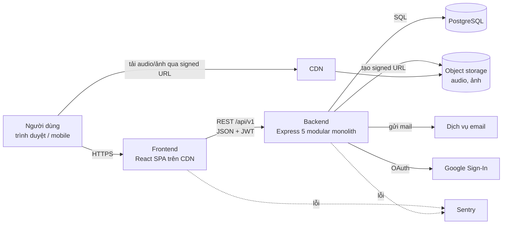
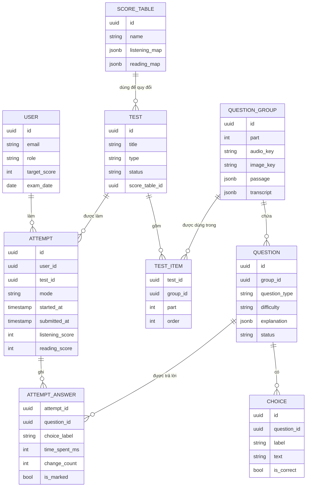
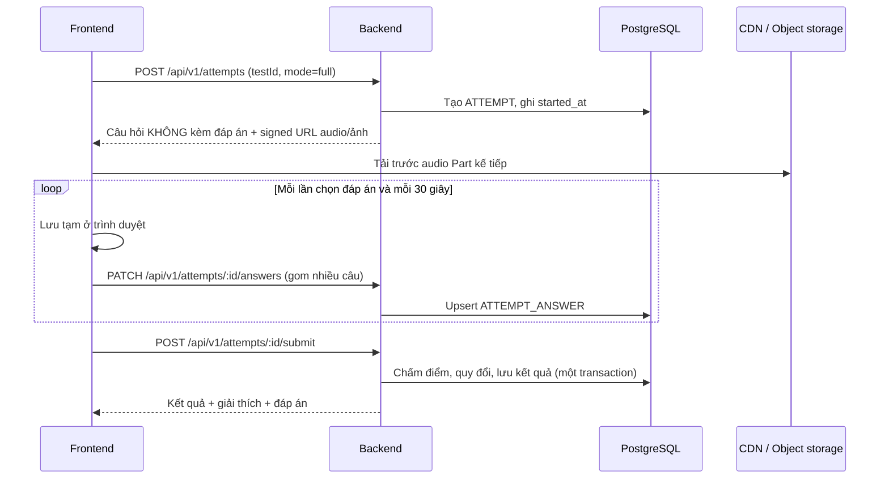

# Kiến trúc TOX – Phiên bản 1 (v1)

| Thuộc tính | Giá trị |
| --- | --- |
| Phiên bản | v1 |
| Trạng thái | Đề xuất (chờ chốt) |
| Ngày | 21/11/2026 |
| Phạm vi | MVP (các yêu cầu `CB-xx` trong [spec](../spec/yeu-cau-ban-dau.md)) |
| Thay thế | Không (phiên bản đầu tiên) |

## 1. Mục tiêu của v1

v1 là kiến trúc **đơn giản nhất đủ để chạy MVP**: một người dùng làm được một đề full test 200 câu giống thi thật, không mất bài khi rớt mạng, xem được điểm và giải thích; đội nội dung soạn và xuất bản được đề.

Nguyên tắc:

- **Ít thành phần nhất có thể.** Một frontend, một backend, một database, một kho lưu file. Chưa tách microservice, chưa dùng hàng đợi.
- **Giữ những gì đã có trong repo.** React + Vite (FSD) ở `web/`, Express 5 + TypeScript ở `backend/`.
- **Thiết kế để nâng cấp được.** Backend chia module rõ ràng để sau này tách ra hoặc thêm worker mà không viết lại.

## 2. Sơ đồ tổng quan

## 3. Thành phần

### 3.1 Frontend (`web/`)

| Hạng mục | Lựa chọn |
| --- | --- |
| Framework | React 19 + TypeScript + Vite (SPA) |
| Kiến trúc code | Feature-Sliced Design (xem [overview.md](./overview.md)) |
| Dữ liệu server | TanStack Query |
| State phía client | Zustand (trạng thái bài đang làm, đồng hồ, câu đánh dấu) |
| UI | Tailwind CSS v4 + shadcn/ui, responsive từ 360px (CB-13) |
| Lưu tạm offline | `localStorage`/IndexedDB giữ đáp án đang làm, đồng bộ lại khi có mạng (CB-06) |
| Triển khai | File tĩnh trên CDN (Cloudflare Pages hoặc Vercel) |

Các slice FSD dự kiến cho MVP:

- `pages/`: home, test-list, exam (phòng thi), practice, result, review, history, profile, auth, cms.
- `features/`: login, take-exam (đồng hồ, điều hướng câu, nộp bài), audio-player, mark-for-review.
- `entities/`: user, test, question, attempt.

### 3.2 Backend (`backend/`)

| Hạng mục | Lựa chọn |
| --- | --- |
| Runtime | Node.js LTS + Express 5 + TypeScript |
| Kiểu kiến trúc | Modular monolith: một ứng dụng, chia module theo nghiệp vụ |
| API | REST, tiền tố `/api/v1`, tài liệu OpenAPI sinh từ Zod (đã có sẵn) |
| Validate | Zod ở mọi request |
| Xác thực | JWT access token ngắn hạn (15 phút) + refresh token trong cookie `httpOnly` (PF-05) |
| Phân quyền | RBAC theo vai trò: guest, student, premium, editor, reviewer, admin |
| Log | Pino (đã có) + Sentry |
| Triển khai | Docker image, chạy trên một dịch vụ container (Render, Railway, Fly.io hoặc VPS) |

Mỗi module giữ cấu trúc Router → Controller → Service → Repository như module `user` hiện tại. Các module của MVP:

| Module | Trách nhiệm | Yêu cầu |
| --- | --- | --- |
| `auth` | Đăng ký, đăng nhập email/Google, quên mật khẩu, refresh token | CB-01 |
| `users` | Hồ sơ, điểm mục tiêu, ngày dự thi; quản lý và khóa tài khoản | CB-02, CB-15 |
| `catalog` | Danh sách đề, lọc theo loại và trạng thái | CB-03 |
| `exam` | Bắt đầu lượt thi, trả câu hỏi **không kèm đáp án**, lưu đáp án, nộp bài, tự nộp khi hết giờ | CB-04 đến CB-07, PF-06 |
| `scoring` | Chấm điểm, quy đổi 5–495 mỗi kỹ năng theo bảng quy đổi | CB-09 |
| `results` | Kết quả theo Part/dạng câu, giải thích, lịch sử, xem lại bài | CB-10 đến CB-12 |
| `content` | CMS: câu hỏi, nhóm câu, đề, quy trình nháp → duyệt → xuất bản | CB-14 |
| `media` | Tải file lên object storage, cấp signed URL | CB-08, PF-03 |
| `community` (P2) | Bình luận, báo cáo, báo lỗi đáp án | CB-17 |

Quy tắc giữa các module: module chỉ gọi nhau qua service, không đọc thẳng bảng của module khác. Đây là điều kiện để tách module ra sau này.

### 3.3 Database: PostgreSQL

Chọn PostgreSQL vì dữ liệu TOEIC có quan hệ rõ (đề → Part → nhóm câu → câu hỏi → lượt làm), cần thống kê theo Part và dạng câu, và cần transaction khi nộp bài. Phần nội dung linh hoạt (giải thích, transcript, dịch nghĩa) có thể để ở cột `JSONB`.

- **ORM / migration:** Drizzle ORM (nhẹ, gần SQL, hợp TypeScript). Prisma là lựa chọn thay thế nếu đội quen hơn.
- **Dịch vụ:** PostgreSQL có quản lý (Neon, Supabase hoặc RDS), sao lưu hằng ngày giữ 30 ngày (PF-13).

Mô hình dữ liệu lõi (PF-12: tách `Question` khỏi `Test`, lưu `Attempt` theo từng câu):

`QUESTION_GROUP` gom các câu dùng chung một audio, ảnh hoặc bài đọc (Part 3, 4, 6, 7). Câu đơn ở Part 1, 2, 5 là nhóm chỉ có một câu.

### 3.4 Thành phần đề xuất thêm

| Thành phần | Vì sao cần ngay ở v1 | Gợi ý |
| --- | --- | --- |
| Object storage + CDN | Audio và ảnh không nên nằm trong DB hay server; cần signed URL để bảo vệ nội dung (PF-03, PF-06) | Cloudflare R2 (không tính phí băng thông ra) hoặc S3 + CloudFront |
| Dịch vụ email | Xác thực email, quên mật khẩu (CB-01) | Resend hoặc Amazon SES |
| Google OAuth | Đăng nhập Google (CB-01) | Google Identity Services |
| Theo dõi lỗi | Biết lỗi khi người dùng đang thi (PF-11) | Sentry cho cả FE và BE |
| CI | Chạy lint, typecheck, test cho mỗi thay đổi | GitHub Actions |
| Hai môi trường | Thử trước khi lên thật (PF-13) | `staging` và `production`, mỗi môi trường có DB và bucket riêng |

## 4. Luồng chính: làm một đề full test

Các điểm cần giữ:

- **Đồng hồ do server quyết định.** Server lưu `started_at` và từ chối đáp án gửi sau giờ cho phép; đồng hồ ở trình duyệt chỉ để hiển thị.
- **Ghi đáp án là idempotent.** Gửi lại cùng một đáp án không gây lỗi, nên frontend có thể thử lại thoải mái khi mất mạng.
- **Đáp án và giải thích chỉ trả về sau khi nộp** (PF-06).

## 5. Bảo mật và vận hành tối thiểu

- HTTPS toàn bộ; Helmet, CORS giới hạn theo domain frontend, rate limit (đã có sẵn trong backend).
- Mật khẩu băm bằng argon2 (hoặc bcrypt).
- Bucket media để riêng tư, chỉ truy cập qua signed URL có hạn ngắn.
- Biến môi trường và secret để trong trình quản lý secret của nền tảng triển khai, không commit vào repo.
- Sao lưu DB hằng ngày, giữ 30 ngày.

## 6. Cố ý chưa làm ở v1

Những phần dưới đây để sang các phiên bản sau, kèm dấu hiệu cho thấy đến lúc cần:

| Chưa làm | Khi nào cần (gợi ý cho v2+) |
| --- | --- |
| Redis (cache, rate limit dùng chung, session) | Chạy từ 2 instance backend trở lên, hoặc DB bắt đầu chậm vì đọc đề lặp lại |
| Hàng đợi + worker (BullMQ) | Có việc chạy nền: gửi email hàng loạt, nhắc học (CC-10), gọi AI (NC-03) |
| Thanh toán (VNPay, MoMo) | Giai đoạn 2, CC-09 |
| Flashcard SRS, sổ lỗi sai, dashboard | Giai đoạn 2, CC-02 đến CC-07 |
| PWA offline đầy đủ | Giai đoạn 2, CC-11 |
| Dịch vụ AI riêng | Giai đoạn 3, NC-03 và NC-06 |
| Tách microservice | Chỉ khi một module cần mở rộng hoặc triển khai độc lập |

## 7. Câu hỏi cần chốt cho v1

- [ ] Đồng ý PostgreSQL + Drizzle, hay muốn dùng Prisma / MongoDB?
- [ ] Nền tảng triển khai: dịch vụ có quản lý (Render, Railway, Fly.io) hay VPS tự quản?
- [ ] Nơi lưu audio: Cloudflare R2 hay AWS S3?
- [ ] Có cần chạy local bằng Docker Compose (Postgres + backend + web) ngay từ đầu không? Đề xuất: có.

## Lịch sử thay đổi

| Phiên bản | Ngày | Thay đổi |
| --- | --- | --- |
| v1 | 21/11/2026 | Bản đề xuất đầu tiên |
