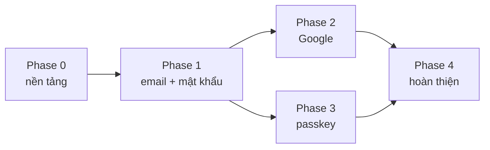

# Tasks: Xác thực (đăng ký, đăng nhập, quên mật khẩu)

| Thuộc tính | Giá trị |
| --- | --- |
| Trạng thái | Chưa bắt đầu |
| Thiết kế | [docs/architecture/auth.md](../architecture/auth.md) |
| Yêu cầu | CB-01, PF-05 ([spec](../spec/yeu-cau-ban-dau.md)) |
| Ước lượng | ~14–19 ngày công (1 dev fullstack) |

## Phạm vi

- Đăng nhập: email + mật khẩu, Google, passkey.
- Đăng ký: email + mật khẩu, CAPTCHA (Cloudflare Turnstile), xác minh email.
- Quên mật khẩu / đặt lại mật khẩu, đổi mật khẩu.
- Trang Bảo mật: passkey, tài khoản liên kết, phiên đăng nhập.

Ngoài phạm vi: 2FA bằng TOTP/SMS, đăng nhập Facebook/Apple, app mobile (khi cần thì bật plugin `bearer`/`jwt`).

Ký hiệu phần: **BE** backend, **FE** web, **Infra** hạ tầng/cấu hình, **Docs** tài liệu.

## Phase 0: Nền tảng (2–3 ngày)

- [ ] **AUTH-01** (Docs) Chốt các câu hỏi ở [mục 12 của thiết kế](../architecture/auth.md#12-câu-hỏi-cần-chốt). Cập nhật PF-05 trong spec và dòng "Xác thực" trong [v1](../architecture/v1.md).
  - Xong khi: thiết kế chuyển trạng thái `Đã chốt`.
- [ ] **AUTH-02** (Infra) Docker Compose cho local: PostgreSQL + Mailpit.
  - Xong khi: `docker compose up` chạy được DB và xem được email ở Mailpit.
- [ ] **AUTH-03** (BE) Thêm Drizzle (`db/`, migration, script `db:migrate`), kết nối qua `DATABASE_URL`.
- [ ] **AUTH-04** (BE) Cài `better-auth` (≥ 1.6.11, pin phiên bản), tạo `api/auth/auth.ts`, `basePath: "/api/v1/auth"`. Sinh schema Better Auth + bảng `auth_event`, chạy migration.
- [ ] **AUTH-05** (BE) Sửa `server.ts`: mount `toNodeHandler(auth)` ở `/api/v1/auth/*splat` **trước** `express.json()`. Thêm biến môi trường mới vào `envConfig` và `.env.template` ([mục 2.4](../architecture/auth.md#24-biến-môi-trường-mới)).
  - Xong khi: `GET /api/v1/auth/ok` trả 200; test hiện có vẫn pass.
- [ ] **AUTH-06** (BE) Middleware `requireSession` và `requireFreshSession`, có test.
- [ ] **AUTH-07** (FE) `shared/api/auth-client.ts`; thay Zustand store trong `entities/session` bằng `useSession()`; route guard cho trang cần đăng nhập; `/` vẫn chọn landing/home theo session.
- [ ] **AUTH-08** (BE) Module gửi email: interface `Mailer`, bản Resend (production) và SMTP/Mailpit (local), template React Email tiếng Việt có bản text thuần. Gửi bất đồng bộ, lỗi thì log.

## Phase 1: Email + mật khẩu (4–5 ngày)

- [ ] **AUTH-10** (BE) Băm mật khẩu Argon2id (`@node-rs/argon2`, m=19 MiB, t=2, p=1) qua `emailAndPassword.password.hash/verify`. Benchmark trên cấu hình server dự kiến, ghi kết quả vào thiết kế.
- [ ] **AUTH-11** (BE) Chính sách mật khẩu: 12–128 ký tự (theo AUTH-01), blocklist (phổ biến, "tox", "toeic", trùng email), plugin `haveIBeenPwned`.
- [ ] **AUTH-12** (BE+FE) CAPTCHA Turnstile: plugin `captcha` cho sign-up, sign-in, request-password-reset; widget `@marsidev/react-turnstile`, reset widget sau mỗi lần gửi; CSP cho `challenges.cloudflare.com`.
  - Xong khi: có test với key test "luôn pass" và "luôn fail".
- [ ] **AUTH-13** (BE+FE) Đăng ký: trang `/register` (tên, email, mật khẩu có hiện/ẩn, thanh đo độ mạnh `zxcvbn-ts`, `autocomplete="new-password"`). Luôn trả cùng thông điệp; email đã tồn tại thì gửi email báo cho chủ tài khoản.
- [ ] **AUTH-14** (BE+FE) Xác minh email: link hết hạn 24 giờ, dùng một lần; trang `/verify-email` có nút xác nhận (POST); gửi lại link có rate limit; `requireEmailVerification: true`.
- [ ] **AUTH-15** (BE+FE) Đăng nhập: trang `/login`, thông báo lỗi chung, `autocomplete="username webauthn"` / `current-password`.
- [ ] **AUTH-16** (BE) Rate limit và khóa tạm: theo IP và theo tài khoản, ngưỡng ở [mục 3.3](../architecture/auth.md#33-rate-limit-và-khóa-tạm-thời); trả 429; mở khóa được bằng quên mật khẩu.
- [ ] **AUTH-17** (BE+FE) Quên mật khẩu: trang `/forgot-password` và `/reset-password`; token 30 phút, dùng một lần; link dựng từ `BETTER_AUTH_URL`; `redirectTo` chỉ nhận đường dẫn nội bộ; thu hồi mọi session; email "mật khẩu đã thay đổi"; không tự đăng nhập.
- [ ] **AUTH-18** (BE+FE) Đổi mật khẩu khi đang đăng nhập (cần mật khẩu hiện tại), thu hồi các session khác.
- [ ] **AUTH-19** (BE+FE) Đăng xuất; danh sách phiên đăng nhập trong trang Bảo mật, thu hồi từng phiên hoặc tất cả.
- [ ] **AUTH-20** (BE) Ghi `auth_event` cho đăng nhập (thành công/thất bại), đăng ký, khóa tạm, yêu cầu reset, đổi mật khẩu. Kiểm tra log không chứa mật khẩu/token/cookie.
- [ ] **AUTH-21** (BE) Integration test Phase 1 ([mục 11](../architecture/auth.md#11-chiến-lược-kiểm-thử)): luồng đầy đủ, thông điệp giống nhau khi email tồn tại/không tồn tại, 429, token hết hạn/dùng lại, reset thu hồi session.

## Phase 2: Google (2–3 ngày)

- [ ] **AUTH-30** (Infra) Google Cloud Console: consent screen, OAuth client Web, origins và redirect URIs cho local/staging/production, scope `openid email profile`, chuyển sang In production ([mục 4.2](../architecture/auth.md#42-cấu-hình-google-cloud-console)).
- [ ] **AUTH-31** (BE+FE) Bật `socialProviders.google`; nút "Tiếp tục với Google" ở `/login` và `/register`; xử lý lỗi callback.
- [ ] **AUTH-32** (BE) Account linking an toàn: `trustedProviders: ["google"]`, `requireLocalEmailVerified: true`, chỉ tự liên kết với `@gmail.com` hoặc có `hd` (nếu AUTH-01 đồng ý).
- [ ] **AUTH-33** (FE) Trang Bảo mật: liên kết/hủy liên kết Google (cần fresh session, không cho hủy phương thức cuối cùng).
- [ ] **AUTH-34** (BE) Test với `oauth2-mock-server`: `state` sai, `aud` sai, `email_verified=false`, liên kết khi email TOX chưa xác minh bị từ chối.

## Phase 3: Passkey (3–4 ngày)

- [ ] **AUTH-40** (BE) Cài `@better-auth/passkey` (rpID từ `PASSKEY_RP_ID`, rpName "TOX", origin từ cấu hình), migration bảng `passkey`.
- [ ] **AUTH-41** (FE) Trang Bảo mật: thêm passkey (đặt tên), danh sách (tên, ngày tạo, lần dùng cuối), đổi tên, xóa (fresh session). Ẩn tính năng nếu trình duyệt không hỗ trợ WebAuthn.
- [ ] **AUTH-42** (BE) Email thông báo khi thêm passkey; ghi `auth_event`.
- [ ] **AUTH-43** (FE) `/login`: nút "Đăng nhập bằng passkey" và conditional UI (`autoFill: true` khi `isConditionalMediationAvailable()`).
- [ ] **AUTH-44** (FE) Gợi ý tạo passkey sau khi đăng nhập bằng mật khẩu hoặc Google (có nút "Để sau", không hỏi lại liên tục).
- [ ] **AUTH-45** (BE+FE) Khôi phục khi mất passkey: tài khoản chỉ có passkey/Google vẫn dùng được quên mật khẩu để đặt mật khẩu lần đầu.
- [ ] **AUTH-46** (FE) E2E Playwright + virtual authenticator: tạo, đăng nhập (nút và autofill), xóa passkey.

## Phase 4: Hoàn thiện (3–4 ngày)

- [ ] **AUTH-50** (FE+BE) Tùy chọn: Google One Tap (plugin `one-tap`, CSP cho `accounts.google.com/gsi/`).
- [ ] **AUTH-51** (Infra) Production: reverse proxy hoặc subdomain cùng site, HTTPS + HSTS, CSP, SPF/DKIM/DMARC cho domain gửi email.
- [ ] **AUTH-52** (BE) Rate limit chuyển sang Redis khi chạy từ 2 instance (có thể hoãn tới v2).
- [ ] **AUTH-53** (BE) Theo dõi: số lần đăng nhập thất bại theo giờ, cảnh báo khi tăng đột biến (credential stuffing).
- [ ] **AUTH-54** (Infra) OWASP ZAP baseline trong CI hoặc chạy tay trước khi lên production; `pnpm audit`.
- [ ] **AUTH-55** (Docs) Review theo [checklist bảo mật](../architecture/auth.md#10-checklist-review-bảo-mật), đánh dấu từng mục.
- [ ] **AUTH-56** (Docs) Runbook: xoay vòng secret, xử lý khi Turnstile/Resend/HIBP lỗi, hỗ trợ người dùng bị khóa hoặc mất quyền truy cập email.
- [ ] **AUTH-57** (Docs) Cập nhật [overview.md](../architecture/overview.md) theo cấu trúc code mới.

## Thứ tự phụ thuộc

Phase 2 và 3 làm song song được. AUTH-32 (linking) phụ thuộc AUTH-14 (xác minh email).

## Lịch sử thay đổi

| Ngày | Thay đổi |
| --- | --- |
| 22/11/2026 | Tạo danh sách task ban đầu |
